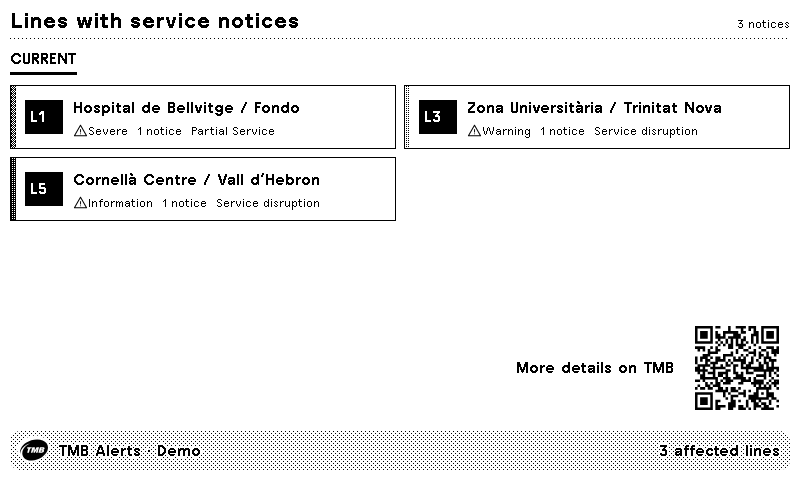

# TMB Metro Alerts

Barcelona Metro service notices on your TRMNL, with affected lines ordered by severity and a QR link to TMB's live status page. Know when things are running smoothly and when to plan another route.

<a href="https://trmnl.com/recipes/247650"></a>

[Install on TRMNL](https://trmnl.com/recipes/247650)



Demo notices, not live service status. [All layout previews](TRMNL/README.md#previews).

## Settings

- **App ID** and **App Key:** register free at the [TMB developer portal](https://developer.tmb.cat/docs/getting-started).
- **Language:** English, Spanish or Catalan (defaults to English).

Full shows all affected lines and the QR code; half horizontal shows up to four lines, half vertical up to seven, and quadrant the two highest-priority lines plus a remaining count. Supports TRMNL OG, BWRY and TRMNL X, including portrait. Data refreshes every 30 minutes.

## Develop locally

Install [trmnlp](https://github.com/usetrmnl/trmnlp). Add `custom_fields.userAppId`, `custom_fields.userAppKey` and `custom_fields.userLanguage` to your local [TRMNL/.trmnlp.yml](TRMNL/.trmnlp.yml), then run from the repository root:

```sh
cd TRMNL
trmnlp serve
```

Keep credentials out of commits and public previews. Templates and settings live in [TRMNL/src/](TRMNL/src/); see the [plugin guide](TRMNL/README.md) for setup and layout details.

Data from [TMB](https://www.tmb.cat/en/barcelona-transport/status-metro-network)'s Metro alerts feed.

[Questions or ideas?](https://github.com/taichikuji/trmnl-tmb-plugin/issues) · [License](LICENSE)
